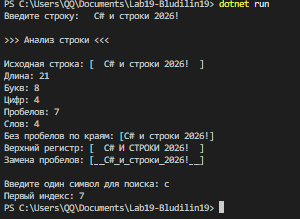

# Практическая работа №19

Автор: Блудилин Артем  
Группа: ИСП-252

## Тема

Строки в C#.

## Что реализовано

- определение длины строки;
- подсчёт букв, цифр, пробелов и слов;
- поиск первого индекса символа;
- удаление пробелов по краям;
- перевод в верхний регистр;
- замена пробелов на подчёркивания.

## Короткие ответы

1. Чем отличаются `string` и `char`?

Ответ: `string` это целая строка, то есть набор символов, и пишется она в двойных кавычках. `char` это один символ, и он пишется в одинарных кавычках. Например, `"П"` это строка из одной буквы, а `'П'` это просто символ.

2. Почему вызов `text.Trim()` без сохранения результата не меняет `text`?

Ответ: строки в C# нельзя изменить после создания. Метод `Trim()` не правит старую строку, а возвращает новую, уже без пробелов. Если никуда её не записать, результат пропадёт, а `text` останется прежним.

3. Зачем при разделении строки используется `RemoveEmptyEntries`?

Ответ: если пробелов подряд несколько или они стоят по краям, `Split` создаёт пустые части, и они посчитаются как слова. С `RemoveEmptyEntries` такие пустые части выбрасываются, и слов считается ровно столько, сколько есть на самом деле.

## Результат

